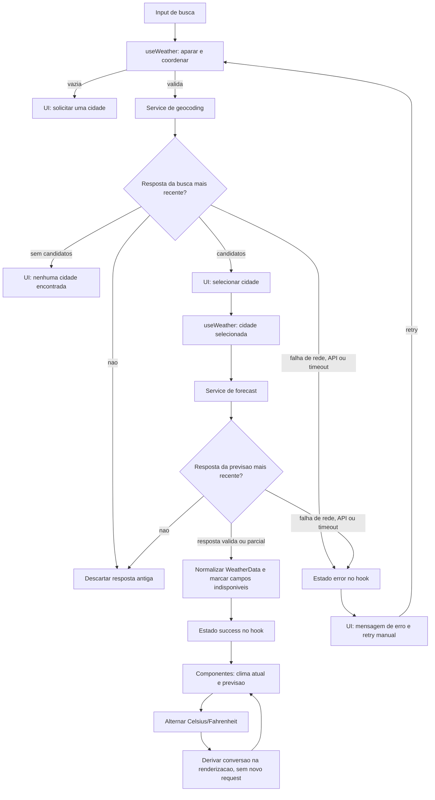

# Plano Técnico — Weather App

Este plano deriva de `specs/weather-app-spec.md`. Ele define arquitetura, decisões e contratos para o MVP; os trechos de TypeScript são tipos de referência, não implementação.

## Architecture

Aplicação web client-side, sem backend próprio. `App` compõe a tela e conecta o hook aos componentes. As dependências seguem uma direção simples: `App` → `hooks` → `services` → APIs externas. `components` recebem dados e callbacks; `lib` contém funções puras usadas pelas camadas que precisam delas; `types` define contratos compartilhados, sem comportamento.

Responsabilidades por camada:

- **Apresentação (`components/`):** renderizar dados, formulários e estados acessíveis; emitir ações por callbacks. Não conhece URLs, DTOs externos nem executa `fetch`.
- **Orquestração e estado (`hooks/`):** controlar busca, cidade selecionada, unidade e estados de loading/erro/vazio; coordenar os serviços, cancelamento e descarte de respostas antigas. Não implementa parsing de HTTP nem regras visuais.
- **Acesso a dados (`services/`):** construir chamadas Open-Meteo, impor timeout, validar respostas e converter DTOs em modelos do domínio. Traduz falhas técnicas para erros conhecidos.
- **Funções puras (`lib/`):** conversão e formatação de temperaturas, rótulos WMO e formatação de datas/horários. Sem estado React, rede ou efeitos colaterais.
- **Contratos (`types/`):** tipos de domínio e DTOs necessários aos serviços; não importar componentes ou hooks.

Essa separação permite testar cada camada com dependências pequenas: `lib` com casos de entrada/saída; `services` com `fetch` mockado e fixtures; hooks com serviços mockados e asserções de transições; componentes com props e interações via Testing Library. Os testes não precisam de uma chamada real à API para validar regras de UI ou estado.

Sem backend, cache, store global, roteador ou camada de repositório no MVP.

## Tech Stack

- TypeScript em modo strict, React 19 e Vite.
- Tailwind CSS 3 para estilos e layout responsivo.
- Open-Meteo Geocoding API e Forecast API, sem chave.
- Vitest + Testing Library para testes unitários e de componentes; Playwright para fluxos E2E.
- Biome para lint e formatação; pnpm como gerenciador de pacotes.
- APIs nativas `fetch`, `AbortController` e `Intl` para rede, cancelamento e formatação. Nenhuma biblioteca adicional é necessária para o escopo.

## Project Structure

Manter a estrutura já definida no README. Cada pasta corresponde a uma responsabilidade acima; dependências externas ficam em `services/` e regras puras ficam em `lib/`:

```text
src/
├── components/
│   ├── states/              # loading, erro e vazio
│   ├── CitySearch.tsx
│   ├── CityResults.tsx
│   ├── CurrentWeather.tsx
│   ├── DailyForecast.tsx
│   └── TemperatureUnitToggle.tsx
├── hooks/
│   └── useWeather.ts        # estado e coordenação do fluxo
├── services/
│   ├── geocoding.ts         # Open-Meteo Geocoding
│   └── forecast.ts          # Open-Meteo Forecast e normalização
├── lib/
│   ├── temperature.ts       # conversão e arredondamento de exibição
│   ├── weather-codes.ts     # códigos WMO para rótulos pt-BR
│   └── formatters.ts        # datas e horários pt-BR
├── types/
│   ├── weather.ts           # modelos de domínio
│   └── open-meteo.ts        # DTOs externos usados pelos serviços
├── styles/
├── App.tsx
└── main.tsx
```

Um componente por arquivo, conforme convenção do projeto. `App.tsx` conecta `useWeather` à apresentação, enquanto componentes permanecem controláveis por props. Não criar abstrações compartilhadas até existir duplicação concreta.

## Data Model

Os dados meteorológicos normalizados permanecem em Celsius; somente a apresentação converte a unidade. Campos potencialmente ausentes são explicitamente opcionais ou nulos, nunca substituídos por zero.

```ts
export type Unit = "celsius" | "fahrenheit";

export interface City {
  /** Identificador da cidade retornado pelo geocoding. */
  id: number;
  /** Nome da cidade. */
  name: string;
  /** Latitude usada nas consultas meteorológicas. */
  latitude: number;
  /** Longitude usada nas consultas meteorológicas. */
  longitude: number;
  /** Região administrativa, quando disponível. */
  admin1?: string;
  /** País, quando disponível. */
  country?: string;
  /** Fuso IANA retornado pelo geocoding, quando disponível. */
  timezone?: string;
}

export interface CurrentWeather {
  /** Temperatura atual em Celsius, correspondente a `temperature_2m`. */
  temperatureC: number | null;
  /** Código WMO da condição atual. */
  weatherCode: number | null;
  /** Horário local da observação, correspondente a `current.time`. */
  observedAt: string | null;
}

export interface ForecastDay {
  /** Data local no formato ISO `YYYY-MM-DD`. */
  date: string | null;
  /** Código WMO da condição prevista para o dia. */
  weatherCode: number | null;
  /** Temperatura mínima em Celsius. */
  temperatureMinC: number | null;
  /** Temperatura máxima em Celsius. */
  temperatureMaxC: number | null;
}

export interface WeatherData {
  /** Cidade selecionada para a consulta. */
  city: City;
  /** Fuso IANA usado para interpretar horários e datas diárias. */
  timezone: string;
  /** Condições atuais retornadas pela API. */
  current: CurrentWeather;
  /** Cinco datas locais: hoje e os quatro dias seguintes. */
  forecast: ForecastDay[];
}

export type WeatherError =
  | { kind: "timeout" }
  | { kind: "network" }
  | { kind: "api"; status?: number; reason?: string }
  | { kind: "invalid-response" };
```

Contratos de serviço:

```ts
export interface GeocodingService {
  searchCities(query: string, signal?: AbortSignal): Promise<City[]>;
}

export interface ForecastService {
  getWeather(city: City, signal?: AbortSignal): Promise<WeatherData>;
}
```

`searchCities` recebe uma consulta já aparada e retorna somente candidatos com nome e coordenadas finitas dentro dos limites de latitude/longitude. `getWeather` usa exatamente as coordenadas da cidade selecionada. Se uma previsão diária vier estruturalmente incompleta ou sem uma data/temperatura mínima/máxima válida, representar a entrada como indisponível; um código meteorológico ausente não invalida temperaturas válidas.

## Data Flow

1. A pessoa envia o formulário; a UI remove espaços periféricos. Consulta vazia não chama a API e informa que é necessário digitar uma cidade.
2. O hook inicia geocoding e expõe loading. O serviço devolve candidatos válidos; lista vazia produz estado vazio e não consulta previsão.
3. A pessoa seleciona um candidato. O hook solicita o clima usando suas coordenadas e mostra loading.
4. O serviço consulta e valida o Forecast API, normalizando clima atual, fuso e exatamente cinco datas locais (hoje e os quatro dias seguintes) em `WeatherData`. Uma entrada com dados ausentes permanece na posição correspondente e é marcada como indisponível.
5. A UI apresenta dados disponíveis, convertendo de Celsius para a unidade ativa apenas na renderização.
6. Alternar unidade atualiza todos os valores sem nova chamada de rede. Recarregar a página restaura Celsius.

Cada nova busca ou seleção invalida a requisição anterior da mesma etapa. Cancelar com `AbortController` quando possível e, adicionalmente, ignorar resultados cuja identificação não corresponda à consulta mais recente, para impedir atualizações fora de ordem.



## External APIs

Usar somente HTTPS e `fetch` encapsulado em `services/`.


### Geocoding

- **URL:** `https://geocoding-api.open-meteo.com/v1/search`
- **Parâmetros:** `name` recebe a busca aparada; `count=10` limita candidatos; `language=pt` pede nomes em português; `format=json` solicita JSON. Este endpoint não usa `current` ou `daily`. Não é necessário enviar `timezone`: o campo pode vir em cada resultado.
- **Exemplo resumido** (valores ilustrativos; propriedades não usadas foram omitidas):

```json
{
  "results": [
    {
      "id": 123456,
      "name": "Campinas",
      "latitude": -22.91,
      "longitude": -47.06,
      "country": "Brasil",
      "admin1": "São Paulo",
      "timezone": "America/Sao_Paulo"
    }
  ]
}
```

- **Mapeamento:** cada `results[]` válido vira um `City`: `id`, `name`, `latitude`, `longitude`, `country`, `admin1` e `timezone` mapeiam diretamente. Descartar candidatos sem nome ou coordenadas finitas/válidas; campos administrativos e `timezone` podem ficar ausentes. A seleção determina exatamente as coordenadas enviadas ao Forecast.

### Forecast

- **URL:** `https://api.open-meteo.com/v1/forecast`
- **Parâmetros:** `latitude` e `longitude` vêm do `City` selecionado; `current=temperature_2m,weather_code` pede condições atuais; `daily=weather_code,temperature_2m_min,temperature_2m_max` pede a previsão diária; `timezone=auto` solicita o fuso da localização; `forecast_days=5` inclui hoje e os quatro dias seguintes; `temperature_unit=celsius` mantém os valores canônicos do modelo em Celsius.
- **Exemplo resumido** (arrays diários reduzidos aqui para legibilidade; a resposta real deve conter cinco datas):

```json
{
  "timezone": "America/Sao_Paulo",
  "current": {
    "time": "2026-10-29T14:00",
    "temperature_2m": 25.4,
    "weather_code": 1
  },
  "daily": {
    "time": ["2026-10-29", "2026-10-30"],
    "weather_code": [1, 3],
    "temperature_2m_min": [18.2, 19.0],
    "temperature_2m_max": [27.1, 28.0]
  }
}
```

- **Mapeamento:** `WeatherData.city` é o `City` selecionado; `WeatherData.timezone` recebe `timezone`. `current.temperature_2m`, `current.weather_code` e `current.time` mapeiam para `CurrentWeather.temperatureC`, `weatherCode` e `observedAt`. Os arrays de `daily` são associados pelo mesmo índice: `time[i]` para `date`, `weather_code[i]` para `weatherCode`, `temperature_2m_min[i]` para `temperatureMinC` e `temperature_2m_max[i]` para `temperatureMaxC`; cada índice gera um `ForecastDay` em `WeatherData.forecast`. A resposta usada em produção deve resultar em exatamente cinco entradas. Não arredondar nem converter temperaturas no serviço.

### Regras de integração

- Cada chamada externa expira em 8 segundos. Sem retry automático; retry manual inicia uma única nova tentativa por ação.
- Tratar status HTTP não bem-sucedido, JSON inválido, campos com tipos incorretos, coordenadas inválidas e arrays diários desalinhados como falhas de integração. Campo meteorológico ausente vira `null` e é apresentado como indisponível, sem substituir por zero.
- Validar antes do release público termos, atribuição exigida, cobertura e limites de requisição do Open-Meteo. Não assumir SLA do provedor.

## State Management

O estado da experiência vive localmente em `useWeather`, com `useState`; referências guardam o controlador/identificador da requisição mais recente. `App` consome o hook e distribui estado e ações aos componentes. Não há necessidade de Context, Redux, cache persistente ou armazenamento local no MVP.

```ts
export type QueryState<T> =
  | { status: "idle" }
  | { status: "loading" }
  | { status: "success"; data: T }
  | { status: "empty" }
  | { status: "error"; error: WeatherError };

export interface WeatherViewState {
  searchQuery: string;
  locations: QueryState<City[]>;
  selectedLocation: City | null;
  weather: QueryState<WeatherData>;
  unit: Unit;
}
```

`locations` e `weather` têm ciclos independentes. `idle` significa que ainda não houve consulta; `loading` indica uma chamada pendente; `success` contém resultados; `empty` é usado quando o geocoding não encontra cidades; `error` representa uma falha que impede usar a resposta. A previsão não usa `empty`: dados meteorológicos parciais permanecem em `success` e os campos ausentes são marcados como indisponíveis. Campo de busca vazio permanece sem chamada e pode mostrar validação local.

A unidade (`unit`) começa em Celsius. `WeatherData` sempre conserva valores Celsius; componentes derivam cada temperatura para exibição com uma função pura, por exemplo `formatTemperature(valueC, unit)`. Em Fahrenheit, calcular $F = C \times 9/5 + 32$ e arredondar ao inteiro mais próximo somente na formatação. Não guardar valores convertidos no estado, não alterar os dados originais e não fazer nova requisição ao alternar unidade. A seleção não é persistida e volta a Celsius ao recarregar.

## Error Handling

- **Busca vazia:** não chamar serviço; manter campo editável e informar a ação necessária.
- **Sem candidatos:** estado `empty` com “Nenhuma cidade encontrada”; não solicitar previsão.
- **Rede:** falha de `fetch` sem resposta HTTP vira erro `network`; encerrar loading, manter a busca disponível e oferecer retry manual.
- **API:** resposta HTTP não bem-sucedida ou payload de erro do Open-Meteo vira erro `api`; registrar o status/motivo apenas para diagnóstico e mostrar mensagem amigável, sem expor detalhes técnicos. Não fazer retry automático.
- **Timeout:** cada chamada expira em 8 segundos via `AbortController`; distinguir timeout de cancelamento intencional de uma requisição antiga. Timeout vira erro `timeout`, encerra loading e oferece uma nova tentativa manual.
- **Resposta inválida:** JSON ilegível ou estrutura incompatível vira `invalid-response`; não renderizar valores inválidos nem converter ausências em zero.
- **Resposta parcial:** campos meteorológicos ausentes são normalizados para `null`, mantendo estado `success` quando os dados ainda podem ser exibidos. Sem temperatura atual válida, marcar o bloco atual inteiro como indisponível. Em cada dia, ausência de data ou de mínima/máxima torna o dia indisponível; ausência apenas do código WMO deixa as temperaturas visíveis e marca a condição como indisponível.
- **Retry e dados antigos:** retry é sempre manual, uma única nova tentativa por ação. Em falha, não apresentar a resposta falha como se fosse atual; quando houver dados atuais válidos, comparar `observedAt` com o relógio e, acima de duas horas, apresentar “Dados desatualizados”.
- **Acessibilidade:** estados de loading e resultado de busca são anunciados por região de status; erros são associados aos controles pertinentes e permanecem disponíveis após retry.

## Testing Strategy

- **Vitest — funções puras (`lib/`):** conversão Celsius/Fahrenheit para valores positivos, negativos e decimais; arredondamento somente na apresentação; rótulos WMO; formatação pt-BR e datas no fuso informado; trimming e preservação de acentos/pontuação.
- **Vitest — serviços (`services/`):** mockar `fetch`; verificar URL, parâmetros e coordenadas; mapear fixtures para os tipos de domínio; cobrir lista vazia, resposta parcial, arrays desalinhados, status HTTP de erro, payload de erro do Open-Meteo, JSON inválido, falha de rede, timeout e cancelamento.
- **Vitest — hooks:** substituir os serviços por mocks e verificar transições `idle/loading/success/empty/error`, retry somente manual, cancelamento e descarte de resposta fora de ordem, além de ausência de chamadas para busca vazia.
- **Vitest — componentes:** renderizar loading, erro, vazio e sucesso; verificar anúncio acessível dos estados, navegação/seleção por teclado, retry e exibição de campos indisponíveis. Alternar unidade deve atualizar todas as temperaturas exibidas sem chamar novamente os serviços.
- **Playwright — fluxos E2E:** interceptar Geocoding e Forecast para manter cenários repetíveis; cobrir busca e seleção, coordenadas do candidato escolhido, previsão de cinco dias, troca de unidade, nenhum resultado sem chamada de forecast, erro/timeout com retry manual e navegação por teclado.
- **Playwright — viewports:** executar o fluxo principal em desktop (1280×800), mobile retrato (320×740) e mobile paisagem (844×390). Verificar ausência de overflow horizontal, controles acessíveis e previsão utilizável; a validação de release complementa esses tamanhos com a faixa 320–1920 CSS px prevista na spec.
- **Validação de release:** uma integração pontual contra respostas reais do Open-Meteo, separada dos E2E mockados; avaliar WCAG 2.2 AA, compatibilidade, desempenho, disponibilidade, responsividade e usabilidade conforme os critérios da spec.
- **Comandos do projeto:** `pnpm lint`, `pnpm build` e `pnpm test`; `pnpm test:e2e` para os fluxos E2E.

## Risks & Trade-offs

| Decisão | Alternativa considerada | Trade-off e justificativa |
|---|---|---|
| Chamar Open-Meteo diretamente do cliente, sem backend. | Criar um BFF/proxy próprio. | Evita hospedagem e código de servidor no MVP; deixa disponibilidade, limites e termos do provedor como dependências externas. Validar as condições antes do release público. |
| Estado local em `useWeather` com `useState`. | Context ou biblioteca global de estado. | A tela única não precisa de estado compartilhado amplo; reduz dependências e indireção, mas não oferece cache ou coordenação global pronta caso o produto cresça. |
| `fetch` nativo e serviços pequenos, sem biblioteca de data fetching. | TanStack Query ou cliente HTTP dedicado. | Evita dependências e mantém timeout/cancelamento explícitos; cache, deduplicação e retries ficam fora do MVP e teriam de ser adicionados se surgirem novos fluxos. |
| Sem cache, persistência local ou modo offline. | Cache em memória, `localStorage` ou service worker. | Preserva a decisão de privacidade e evita dados potencialmente obsoletos; pode repetir chamadas após nova consulta ou reload e depende da disponibilidade da API. |
| Retry apenas manual, sem repetição automática. | Retry automático com backoff. | Evita tráfego inesperado e respeita a regra da spec; exige ação adicional da pessoa diante de falhas transitórias. |
| Celsius como unidade canônica; conversão e arredondamento na apresentação. | Pedir Fahrenheit ao endpoint ou persistir valores convertidos. | Uma resposta serve às duas unidades e evita deriva por conversões sucessivas; requer conversão local e testes de arredondamento. |
| `Intl` e APIs nativas para formato/data/rede. | Adicionar bibliotecas especializadas. | Menos dependências e payload; testes precisam fixar locale/fuso, e funcionalidades de data mais complexas podem justificar biblioteca depois. |
| Vitest com `fetch` mockado e E2E com rotas interceptadas; integração real pontual antes do release. | Fazer todo E2E contra a API real. | Fixtures tornam falhas e estados raros determinísticos e rápidos; não substituem a validação de contrato real, que permanece como gate pré-release. |